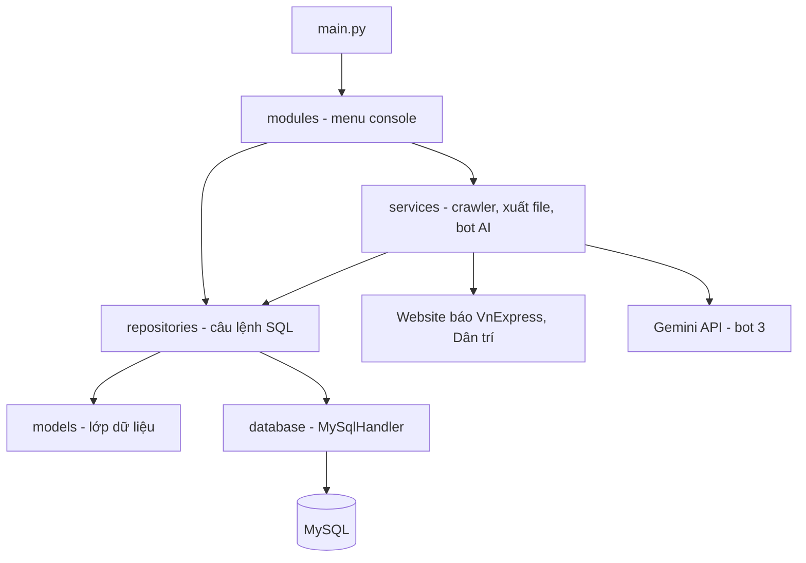
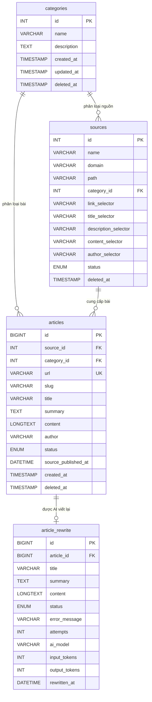

# Link Video Demo Sản phẩm: https://drive.google.com/file/d/1RnI9ygWHV8iI4LOu96C47kp-QYDyDuoW/view?usp=sharing

# Ứng dụng Console tổng hợp và quản lý tin tức đa nguồn (News Crawler)

Bài tập lớn Python: chương trình chạy hoàn toàn trên Console/Terminal, thu thập tin tức từ nhiều báo điện tử, lưu vào MySQL và cho phép quản lý nguồn tin, tin tức. Chương trình có menu 2 tầng, cào dữ liệu từ 2 báo (VnExpress, Dân trí), chống trùng bài theo URL, và các điểm cộng: lịch tự động, xuất file, đa luồng.

## 1. Công nghệ

| Thành phần | Chi tiết |
|---|---|
| Ngôn ngữ | Python 3.x (đã chạy trên Python 3.12 và 3.14, hệ điều hành Windows) |
| Cơ sở dữ liệu | MySQL (UTF-8, `utf8mb4`) |
| Thư viện | `mysql-connector-python`, `requests`, `beautifulsoup4`, `apscheduler` |
| Kiểu lập trình | Hướng đối tượng, phân tầng `models` / `repositories` / `services` / `modules` / `database` |

## 2. Đối chiếu với yêu cầu của đề

| Yêu cầu của đề | Hiện thực | Vị trí trong mã |
|---|---|---|
| Menu 2 tầng, có vòng lặp và đường thoát | Menu chính (1, 2, 3, 0) và các menu con, nhập sai thì báo lỗi và hỏi lại | `modules/main_menu.py`, `source_menu.py`, `news_menu.py`, `crawler_menu.py` |
| 1.1 Xem danh sách nguồn: ID, Tên, URL, Trạng thái | In dạng bảng, trạng thái Active/Inactive | `modules/source_menu.py` |
| 1.2 Thêm nguồn: tên, URL, selector CSS | Nhập tên, domain, path, chọn chuyên mục, nhập các selector | `modules/source_menu.py` |
| 1.3 Cập nhật nguồn | Sửa tên, domain, path và các selector, Enter để giữ nguyên | `modules/source_menu.py` |
| 1.4 Xóa nguồn hoặc đổi trạng thái | Cả hai: 1.4 xóa nguồn (xóa mềm, giữ lại bài đã cào), 1.5 đổi Active/Inactive | `modules/source_menu.py`, `repositories/source_repository.py` |
| 2.1 Xem tin có phân trang bằng `<` và `>` | 10 bài mỗi trang, `<` trang trước, `>` trang sau, `0` thoát | `modules/news_menu.py` |
| 2.2 Tìm theo tiêu đề hoặc từ khóa trong nội dung | Tìm trong cả tiêu đề và nội dung | `modules/news_menu.py`, `repositories/news_repository.py` |
| 2.3 Lọc theo nguồn hoặc ngày cào | Lọc theo nguồn, hoặc theo ngày cào (định dạng `YYYY-MM-DD`) | `modules/news_menu.py` |
| 2.4 Xem chi tiết một bài | Tiêu đề, Tóm tắt, Nội dung, Đường dẫn gốc, Ngày đăng | `modules/news_menu.py` |
| 2.5 Xóa bài trùng lặp hoặc quá cũ | Xóa một bài theo ID (có xác nhận) hoặc xóa bài cũ hơn N ngày, đều là xóa mềm | `modules/news_menu.py` |
| 3. Chạy crawler: tất cả nguồn Active hoặc một nguồn | Menu 3.1 chọn `0` (tất cả nguồn Active) hoặc ID một nguồn | `modules/crawler_menu.py` |
| Lấy tiêu đề, link, tóm tắt, thời gian xuất bản, nội dung chi tiết | Bot 1 lấy link, bot 2 lấy chi tiết từng bài | `services/*_crawler_service.py` |
| Xử lý trùng lặp theo URL | `UNIQUE(url)` trong CSDL kết hợp `INSERT IGNORE` | `database/schema.sql`, `repositories/news_repository.py` |
| Hiển thị tiến trình trên Console | Ví dụ `[VnExpress] Đã cào 5 bài mới...` | `services/*_crawler_service.py` |
| Cào thành công từ ít nhất 2 nguồn báo | VnExpress và Dân trí (thêm chuyên mục Thể thao, Đời sống của Dân trí) | `services/vnexpress_crawler_service.py`, `dantri_crawler_service.py` |
| Thiết kế CSDL chuẩn hóa, khóa chính, khóa ngoại, unique cho URL | Xem mục 5 | `database/schema.sql` |
| Xử lý ngoại lệ: mất mạng, HTTP 404, lỗi kết nối MySQL, nhập sai định dạng | Xem mục 8 | `services/crawler_service.py`, `database/mysql_handler.py`, `modules/utils.py` |
| Điểm cộng: lịch tự động (`APScheduler`) | Menu 3.2, nhập biểu thức crontab | `modules/crawler_menu.py` |
| Điểm cộng: xuất CSV, JSON | Menu 2.6 | `services/export_service.py`, `modules/export_menu.py` |
| Điểm cộng: đa luồng (`concurrent.futures`) | `ThreadPoolExecutor` ở bước lấy chi tiết bài | `services/crawler_service.py` (`run_parallel`) |

## 3. Cấu trúc thư mục

```text
(thư mục gốc dự án)
├── main.py                       Điểm khởi chạy: kết nối DB, tạo repository, chạy menu chính
├── config.py                     Cấu hình DB và AI, đọc từ biến môi trường hoặc file .env
├── .env.example                  Mẫu file .env (không chứa bí mật)
├── .gitignore
├── check_gemini.py               Công cụ kiểm tra khóa và model AI (chỉ dùng cho bot 3)
├── database/
│   ├── schema.sql                Tạo CSDL, 4 bảng và dữ liệu mẫu
│   └── mysql_handler.py          Lớp kết nối MySQL (query, execute, bắt lỗi kết nối)
├── models/                       Lớp dữ liệu, mỗi lớp ứng với một bảng
│   ├── category.py
│   ├── source.py
│   ├── article.py
│   └── article_rewrite.py
├── repositories/                 Mọi câu lệnh SQL nằm ở đây
│   ├── category_repository.py
│   ├── source_repository.py
│   ├── news_repository.py
│   └── rewrite_repository.py
├── services/                     Nghiệp vụ
│   ├── crawler_service.py        Lớp cha của mọi crawler, hàm dùng chung, tự nạp file nguồn
│   ├── vnexpress_crawler_service.py
│   ├── dantri_crawler_service.py
│   ├── export_service.py         Xuất CSV và JSON
│   ├── gemini_client.py          Gọi Gemini API (bot 3)
│   └── rewrite_service.py        Điều phối bot 3
└── modules/                      Giao diện console (các menu)
    ├── main_menu.py
    ├── source_menu.py
    ├── news_menu.py
    ├── crawler_menu.py
    ├── export_menu.py
    ├── rewrite_menu.py
    └── utils.py                  Hàm nhập liệu và in bảng
```

Thư mục `exports/` được tạo tự động khi xuất file và không đưa lên git.

## 4. Kiến trúc



- **`modules`** chỉ lo hiển thị và nhận dữ liệu nhập, không chứa câu lệnh SQL.
- **`services`** chứa nghiệp vụ: tải trang, bóc tách HTML, xuất file, gọi AI.
- **`repositories`** là nơi duy nhất viết SQL, trả về đối tượng hoặc dữ liệu cho tầng trên.
- **`database`** quản lý kết nối. Mỗi lần truy vấn mở một kết nối riêng nên an toàn khi dùng đa luồng.

**Lập trình hướng đối tượng cho crawler.** `CrawlerService` là lớp cha trừu tượng, có sẵn các hàm dùng chung (`fetch`, `extract_links`, `get_text`, `get_all_text`, `run_parallel`). Mỗi báo là một lớp con trong một file riêng, kế thừa `CrawlerService`, khai báo `DOMAIN` và cài đặt hai hàm:

- `crawl_fresh_link()` (bot 1): tải trang nguồn, lấy danh sách link bài, lưu vào DB với trạng thái `pending`, bỏ qua link đã có.
- `crawl_link_detail()` (bot 2): lấy các bài `pending`, tải chi tiết song song nhiều luồng, lưu tiêu đề, tóm tắt, nội dung, tác giả, ngày đăng và đổi trạng thái thành `completed`.

Khi chạy crawler, chương trình tự quét thư mục `services`, tìm lớp con có `DOMAIN` trùng với cột `domain` của nguồn. Vì vậy thêm một báo mới không phải sửa mã ở các tầng khác (xem mục 10).

## 5. Thiết kế CSDL



Sơ đồ chỉ liệt kê các cột chính, danh sách đầy đủ nằm trong `database/schema.sql`.

| Bảng | Vai trò | Khóa và ràng buộc chính |
|---|---|---|
| `categories` | Chuyên mục (ví dụ Tin tức tổng hợp, Thể thao, Đời sống) | Khóa chính `id` |
| `sources` | Nguồn tin. URL của nguồn là `https://` + `domain` + `path` | Khóa chính `id`; khóa ngoại `category_id` trỏ tới `categories(id)`, `ON DELETE RESTRICT`; `status` là `active` hoặc `deactive` |
| `articles` | Bài viết đã cào | Khóa chính `id`; khóa ngoại `source_id` và `category_id` (`ON DELETE RESTRICT`); **`UNIQUE KEY unique_url (url)`** chống trùng bài; `status` là `pending`, `completed` hoặc `deleted` |
| `article_rewrite` | Bản viết lại của bài do AI tạo (bot 3, tùy chọn) | Khóa ngoại `article_id` trỏ tới `articles(id)`; `UNIQUE(article_id)` nên mỗi bài chỉ có một bản viết lại; chỉ mục theo `status` |

Một số quyết định thiết kế:

- **Xóa mềm.** Các bảng có cột `deleted_at`. Xóa nguồn hoặc xóa bài chỉ đặt `deleted_at` (bài còn đổi `status` thành `deleted`), nên dữ liệu không mất và khóa ngoại `RESTRICT` không bị vi phạm.
- **Vòng đời của bài viết.** `pending` (mới lấy được link) chuyển thành `completed` (đã lấy xong chi tiết), và thành `deleted` khi người dùng xóa.
- **Cột selector trong `sources`** lưu cấu hình theo yêu cầu mục 1.2. Mỗi báo có lớp crawler riêng với selector viết sẵn trong mã.

## 6. Xử lý trùng lặp và xử lý ngoại lệ

**Chống trùng bài.** Cột `url` của bảng `articles` có ràng buộc `UNIQUE`. Khi lưu link, chương trình dùng `INSERT IGNORE`: link đã có thì bị bỏ qua và không được đếm là bài mới.

**Xử lý ngoại lệ.** Chương trình in thông báo và tiếp tục chạy, không dừng đột ngột:

| Tình huống | Cách xử lý | Vị trí |
|---|---|---|
| Mất mạng, hết thời gian chờ | Bắt `ConnectionError` và `Timeout`, in thông báo kèm tên loại lỗi, bỏ qua trang đó | `services/crawler_service.py` (`fetch`) |
| Lỗi HTTP (404, 500...) | Bắt `HTTPError`, in mã lỗi và địa chỉ, bỏ qua trang đó | `services/crawler_service.py` (`fetch`) |
| Lỗi kết nối MySQL | Bắt lỗi của `mysql.connector`, in `Lỗi kết nối MySQL: ...`, trả về kết quả rỗng thay vì dừng | `database/mysql_handler.py` |
| Nhập sai định dạng | Ô nhập số hỏi lại đến khi hợp lệ, ngày sai định dạng bị từ chối, lựa chọn menu sai được báo lỗi | `modules/utils.py`, `modules/*_menu.py` |
| Website giới hạn tốc độ (HTTP 429) | Nhận ra trang chặn, chờ rồi thử lại, không lưu trang chặn như một bài viết | `services/crawler_service.py` |

Bài nào không lấy được nội dung thì giữ trạng thái `pending` và được thử lại ở lần chạy sau, không lưu dữ liệu rỗng.

## 7. Điểm cộng

### Đa luồng

Bước lấy chi tiết bài (bot 2) chạy song song bằng `concurrent.futures.ThreadPoolExecutor` trong hàm `run_parallel` của `services/crawler_service.py`. Các hằng số điều chỉnh trong cùng file:

- `MAX_WORKERS`: số luồng tải bài cùng lúc.
- `REQUEST_DELAY`: số giây nghỉ trước mỗi yêu cầu.

Tốc độ được **cố ý giới hạn** để không bị website chặn (đã từng gặp HTTP 429 khi cào với nhiều luồng và không nghỉ). Các nguồn trong một lượt cào chạy lần lượt, chỉ các bài trong cùng một nguồn được tải song song.

### Lịch tự động

Menu `3.2` dùng `APScheduler` (`BackgroundScheduler` và `CronTrigger`). Người dùng nhập biểu thức crontab 5 trường `phút giờ ngày tháng thứ`:

| Biểu thức | Ý nghĩa |
|---|---|
| `*/30 * * * *` | Mỗi 30 phút (mặc định khi nhấn Enter) |
| `0 8 * * *` | 8 giờ sáng mỗi ngày |
| `*/5 9-17 * * 1-5` | Mỗi 5 phút trong khung 9h đến 17h, từ thứ Hai đến thứ Sáu |

Chương trình hiện các thời điểm chạy kế tiếp để xác nhận, có thể cào ngay một lượt trước khi chờ lịch, và nhấn `Ctrl+C` để dừng và quay lại menu. Lịch dưới 10 phút một lần sẽ có cảnh báo vì dễ bị website chặn. Mỗi lượt chạy tuần tự (không chồng lượt), một lượt gặp lỗi không làm dừng lịch. Trường "thứ" được đổi sang chuẩn crontab (`0` hoặc `7` là Chủ Nhật, `1` là Thứ Hai) vì APScheduler đánh số lệch chuẩn này.

### Xuất báo cáo

Menu `2.6` xuất toàn bộ bài đã cào xong (chưa bị xóa) ra thư mục `exports/`:

- **CSV** (mã hóa `utf-8-sig` để Excel mở đúng tiếng Việt) và **JSON** (giữ nguyên chữ có dấu).
- Các cột: `id`, `source_name`, `title`, `url`, `summary`, `content`, `author`, `source_published_at`, `created_at`.
- Tên file có ngày giờ nên mỗi lần xuất là một file mới.

## 8. Thêm một báo mới

1. Tạo file `services/<tên>_crawler_service.py` (tên file phải kết thúc bằng `_crawler_service.py`).
2. Viết một lớp kế thừa `CrawlerService`, đặt `DOMAIN` bằng tên miền (khớp cột `domain` của nguồn), rồi cài đặt `crawl_fresh_link()` và `crawl_link_detail()`. Có thể sao chép `vnexpress_crawler_service.py` làm mẫu và dùng các hàm sẵn có `fetch`, `extract_links`, `get_text`, `get_all_text`, `run_parallel`.
3. Dùng menu `1.2` thêm nguồn với đúng `domain` đó.

Nếu trong CSDL có nguồn mà chưa có file crawler tương ứng, chương trình in cảnh báo `Chưa có file crawler cho domain ...` và bỏ qua nguồn đó.

## 9. Chức năng mở rộng ngoài đề

**Bài đặc biệt.** Một số bài (video, trang dựng bằng JavaScript) không có văn bản trong HTML. Chương trình lưu tạm tiêu đề, tóm tắt, ngày đăng và tác giả lấy từ thẻ meta, còn nội dung là một câu ghi chú bắt đầu bằng `[Bài đặc biệt]`. Tìm lại các bài này bằng `WHERE content LIKE '[Bài đặc biệt]%'`.

**Bot 3: AI viết lại bài (tùy chọn).** Menu `3.3` lấy các bài đã cào có nội dung văn bản thật, gửi cho Google Gemini để viết lại, và lưu vào bảng `article_rewrite`. Chương trình vẫn chạy bình thường khi không dùng bot này.

- Cần khóa Google AI Studio. Điền `GEMINI_API_KEY` và `GEMINI_MODEL` vào `.env`. Tên model thay đổi theo thời gian: chạy `python check_gemini.py` để thử model nào còn dùng được với khóa của bạn.
- Gọi API bằng thư viện `requests` (không cần SDK). Gặp lỗi tạm thời thì thử lại, hết hạn mức thì bài đó không bị ghi lỗi để chạy lại sau.
- Gói miễn phí có hạn mức thấp nên mỗi lượt chỉ xử lý một số bài (mặc định 5).
- Bản viết lại do AI tạo ra có thể lệch ý so với bài gốc, nên hãy đối chiếu khi cần dùng. Bảng giữ `article_id` để luôn truy ngược được bài gốc.


